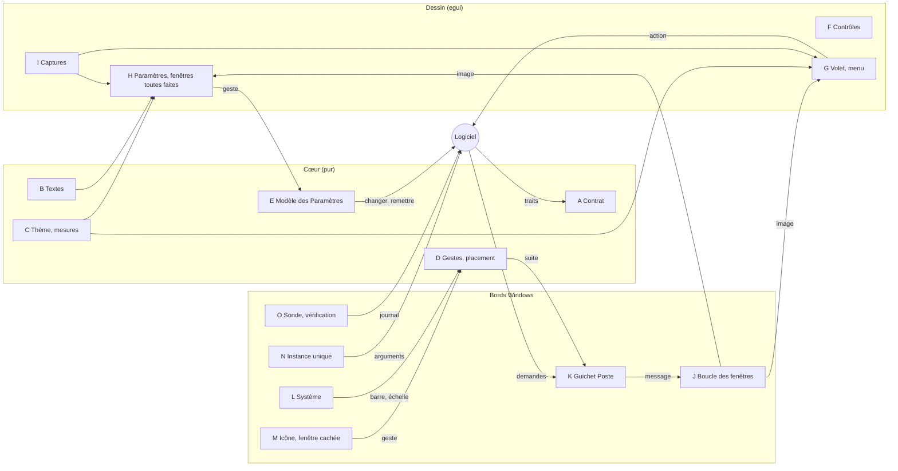

# Interface commune — l'organisation idéale (étape 1 de la refonte « code propre »)

| Projet | Date | Version de l'organigramme | Relu par |
|---|---|---|---|
| Interface commune | 2026-11-24 | 1 (idéal, avant lecture du code) | à relire par un sous-agent neuf, puis l'Atelier Master |

**Comment ce document a été écrit.** D'après les documents seulement : `README.md`,
`docs/CARTE.md`, `docs/ETAT.md`, `docs/MIGRATION.md`, la fiche commune « Interface Windows 11 »,
l'organigramme de Vocalis et les documents de la refonte de PowerPeek (`IDEAL.md`, `ANALYSE.md`),
qui disent ce que ces projets attendent de la bibliothèque. **Le dossier `src/` n'a pas été ouvert
avant d'écrire ce document** (méthode, §5, étape 1) : c'est le plan qu'on dessinerait sur une page
blanche, pour ne pas recopier les défauts du code actuel. La comparaison avec le code est dans
`docs/ANALYSE.md`.

Mots employés :
- une **crate** est un paquet de code Rust compilé à part ; le compilateur y interdit ce qu'on n'y
  veut pas (par exemple : aucun appel à Windows) ;
- une **API** (interface de programmation) est l'ensemble des fonctions et des types que les
  logiciels appellent ; la changer oblige chaque logiciel à changer son code ;
- le **rendu**, c'est ce qui s'affiche au pixel près ;
- **egui** est la bibliothèque qui dessine les fenêtres ; **eframe** et **winit** l'attachent à
  Windows (une seule boucle de fenêtres par programme, imposée par winit) ;
- un **fil** est une partie du programme qui tourne en parallèle des autres.

---

## 1. L'idée en trois phrases

L'Interface commune donne aux logiciels du propriétaire qui vivent près de l'horloge de Windows
(KVMSoft, Vocalis, PowerPeek, Chat PDC) **la même allure Windows 11 et le même comportement** :
l'icône, le volet, le petit menu, les Paramètres, les fenêtres et leurs contrôles. Le logiciel ne
décrit que ce qui lui est propre (son nom, ses pages, ses réglages, ses actions), par deux traits
(`Reglages` et `Logiciel` : la liste de ce qu'il doit savoir répondre). Tout ce qui se décide
(quel geste ouvre quoi, où poser le volet, quelle page montrer, que remettre à « Annuler ») est
calculé sans fenêtre et testé avec des exemples, et le code qui parle à Windows est mince et ne
décide rien.

## 2. Les principes propres à cette bibliothèque

1. **L'API est un contrat.** Quatre logiciels en dépendent, chacun épinglé sur un commit. Une
   fonction publique ne disparaît pas sans une étape « dépréciée » (marquée, encore là, avec la
   ligne de remplacement dans `MIGRATION.md`) d'au moins une version. Toute nouveauté arrive en
   option, avec une valeur par défaut qui ne change rien (déjà la pratique : à garder).
2. **Le rendu est un contrat aussi.** Chaque écran commun (volet, petit menu, chaque page commune
   des Paramètres, fenêtres toutes faites, contrôles) a une **image de référence** en clair et en
   sombre, à 100 % et 150 %, faite sans fenêtre. Un changement de rendu non voulu fait échouer un
   test ; un changement voulu remplace l'image dans le même commit et se note dans `MIGRATION.md`.
3. **Trois étages, imposés par le compilateur** :
   - le **cœur** : aucune dépendance ni à Windows ni à egui ; il reçoit des faits (un clic, une
     taille d'écran, l'heure) et rend des décisions ; `#![forbid(unsafe_code)]` ;
   - le **dessin** : egui seul, jamais Windows ; il dessine ce que le cœur a décidé ; il se teste
     sans fenêtre (mise en page par egui, captures PNG) ;
   - les **bords Windows** : le seul endroit qui appelle Windows, le seul où `unsafe` est permis ;
     ils transportent, ils ne choisissent pas.
4. **La bibliothèque n'écrit rien sur le disque d'elle-même.** Le journal, la place retenue des
   Paramètres et les réglages passent par le logiciel (`Logiciel::noter`, `Reglages::retenir_place`,
   `Reglages::changer`). Seule exception, sur demande expresse : les captures PNG.
5. **Aucune donnée de l'utilisateur dans le journal** : seulement des noms écrits dans le code
   (déjà la règle de la sonde ; à garder partout).
6. **Une seule copie de chaque mesure, couleur, durée et mot** : `mesures`, `theme`, `textes`.
   Aucun nombre magique ailleurs.

## 3. Les blocs

Quinze blocs au plus (gabarit). Les cinq premiers sont dans le cœur, les quatre suivants dans le
dessin, les six derniers dans les bords.

### 3.1 Le cœur (crate `ic-coeur`, pure)

#### A. Le contrat (traits et types partagés)
- **Rôle** : définir ce que le logiciel fournit (`Reglages`, `Logiciel`, `Identite`, `Etat`,
  `Communs`, les clés communes) et ce qu'il reçoit (les `Valeur`, les `Brique`, les actions).
- **Ne fait pas** : dessiner, ouvrir une fenêtre, appeler Windows. Les méthodes qui dessinent
  (`dessiner_page`…) ne sont pas ici : elles sont dans le dessin (bloc F), sous forme d'un
  prolongement du trait.
- **Entrées / sorties** : rien à l'exécution ; ce sont des types.
- **Touche le système ?** non.
- **Test sans matériel** : un faux logiciel de données inventées (`Exemple`), réutilisé par tous
  les autres tests.

#### B. Les textes
- **Rôle** : chaque mot écrit par la bibliothèque, en français et en anglais, dans un seul
  catalogue (`Textes`), changeable en direct ; la mise en forme des raccourcis en toutes lettres
  (`touches::lisible`).
- **Ne fait pas** : choisir la langue (c'est le logiciel).
- **Entrées / sorties** : une langue → un `&Textes` ; une écriture de raccourci → un texte lisible.
- **Touche le système ?** non.
- **Test sans matériel** : les deux catalogues ont les mêmes champs, aucun vide ; `lisible` ne
  change pas deux fois ; chaque caractère existe dans les polices (bloc O).

#### C. Le thème et les mesures (valeurs)
- **Rôle** : la palette Fluent clair et sombre, les couleurs d'état, les couleurs des pastilles
  (10, ΔE2000 ≥ 12), les durées d'animation et leur courbe, les mesures du volet, du menu et des
  Paramètres, le calcul d'une image d'animation (opacité à l'instant t, image par image).
- **Ne fait pas** : lire le mode sombre ni l'accent dans Windows (bord L), ni charger les polices
  (bord L).
- **Entrées / sorties** : clair ou sombre, l'accent, « effets d'animation » oui ou non, le temps
  écoulé → couleurs, tailles, opacité.
- **Touche le système ?** non.
- **Test sans matériel** : contrastes (4,5:1, 3:1), écart des pastilles (paires de Sharma),
  courbe d'animation à des instants donnés, animation jouée en entier même après une image
  retardée.

#### D. Les gestes et le placement
- **Rôle** : traduire ce que fait l'utilisateur sur l'icône (appui, relâche, double-clic,
  clavier) en une suite (volet, petit menu, fenêtre principale, Paramètres, rien), avec
  l'anti-rebond (400 ms) et le second clic qui referme ; l'ordre du petit menu ; calculer la place
  du volet et du menu près de l'icône et de la barre des tâches, la hauteur bornée, le plan des
  écrans d'un choix illustré, la place au changement d'échelle.
- **Ne fait pas** : demander à Windows où est la barre ni l'heure (elles arrivent en paramètre).
- **Entrées / sorties** : un geste et l'heure, le réglage « fenêtre principale » → une suite ;
  la place de l'icône, de la barre et de la zone de travail, la taille voulue → un rectangle.
- **Touche le système ?** non.
- **Test sans matériel** : tables d'exemples (barre en bas, en haut, à gauche, écrans à 100 % et
  150 %, écrans aux coordonnées négatives ; rafales de clics avec une fausse horloge).

#### E. Le modèle des Paramètres
- **Rôle** : tout ce qui se décide dans les Paramètres sans les dessiner : la liste des pages
  (Accueil facultatif, pages du logiciel, puis Général, Mise à jour, À propos), la navigation, la
  recherche (dès 7 pages, accents et majuscules sans importance, sections trouvées), le point
  d'alerte, la page demandée (`--parametres <page>`, notification), « Annuler » (6 s, un geste =
  une bulle, brouillon entier), « Conserver ces modifications ? » (15 s, une à la fois),
  « Redémarrer maintenant », la présentation de la page Mise à jour (état → icône, titre, ligne
  grise, bouton), le suivi des pages arrivées après l'ouverture.
- **Ne fait pas** : dessiner, ni lire l'heure (elle arrive en paramètre), ni enregistrer.
- **Entrées / sorties** : les pages et les `Communs` du logiciel, les gestes de l'utilisateur,
  l'heure → l'état des Paramètres (page montrée, bulle, compte à rebours) et les changements à
  envoyer au logiciel (`changer`, `remettre`).
- **Touche le système ?** non.
- **Test sans matériel** : suites de gestes avec une fausse horloge (bulle qui expire, retour
  après 15 s, nouveau changement pendant un compte à rebours, page disparue).

### 3.2 Le dessin (crate `ic-dessin`, egui seul)

#### F. Les contrôles communs
- **Rôle** : cartes, interrupteur (écrit ou non), bandeau, boutons, champ de raccourci, roue
  dentée, nuancier, choix de couleur, barre à seuils, menu flottant de choix, section repliable,
  icônes communes (glyphes Segoe).
- **Ne fait pas** : décider (les touches du menu de choix, le placement, la recherche viennent du
  cœur).
- **Entrées / sorties** : une palette, des textes, la valeur courante → ce que l'utilisateur a
  fait (valeur changée, choix).
- **Touche le système ?** non.
- **Test sans matériel** : mise en page egui sans fenêtre ; images de référence ; navigation au
  clavier simulée (Tab, flèches, Entrée, Échap) ; noms pour le lecteur d'écran.

#### G. Le volet et le petit menu (dessin)
- **Rôle** : dessiner le volet (titre = nom du logiciel, version à sa droite, roue en haut à
  droite, ligne d'état, briques, pied fixe, défilement au-delà de la hauteur maximale) et le petit
  menu (lignes de 32 + 2, icône, gras pour « Ouvrir <logiciel> »).
- **Ne fait pas** : décider de la place ni de l'ordre du menu (bloc D), gérer la fenêtre (bloc J).
- **Entrées / sorties** : `Etat`, briques, lignes du menu → le choix fait (clé, réglage changé,
  Paramètres, fermer).
- **Touche le système ?** non.
- **Test sans matériel** : deux images de suite ne reconstruisent rien ; images de référence ;
  titre coupé par « … » sans passer sous la roue.

#### H. Les Paramètres (dessin) et les fenêtres toutes faites
- **Rôle** : dessiner le squelette des Paramètres (en-tête avec logo, navigation, recherche,
  pages communes, bulle « Annuler », carte « Conserver ? », bandeau, pied) d'après l'état du
  bloc E, et appeler les pages du logiciel ; dessiner la fenêtre simple, la fenêtre « est
  prête » et la fenêtre de lecture.
- **Ne fait pas** : décider de la page, de la bulle ni du compte à rebours (bloc E) ; ouvrir la
  fenêtre (bloc J).
- **Entrées / sorties** : l'état du bloc E, le logiciel → les gestes, rendus au bloc E.
- **Touche le système ?** non.
- **Test sans matériel** : images de référence de chaque page commune et de chaque état de la
  page Mise à jour ; recherche qui ouvre une section.

#### I. Les captures
- **Rôle** : faire des PNG du volet, du petit menu, des Paramètres et de tout dessin, sans
  fenêtre, pour la documentation et pour les images de référence.
- **Ne fait pas** : ouvrir une fenêtre, lire l'écran.
- **Entrées / sorties** : un logiciel (souvent inventé), une échelle, clair ou sombre → des PNG.
- **Touche le système ?** disque, seulement pour écrire les PNG demandés.
- **Test sans matériel** : c'est lui qui rend possibles les tests de rendu.

### 3.3 Les bords Windows (crate `ic-windows`, seul `unsafe`)

#### J. La boucle des fenêtres
- **Rôle** : la seule boucle eframe du programme. Sa fenêtre principale est celle du volet et du
  petit menu, préparée au repos, voilée jusqu'à son ouverture, jamais refaite ; elle dessine aussi
  les autres fenêtres (Paramètres, fenêtres du logiciel). Elle attrape une panique d'eframe,
  recrée la fenêtre et refait le clic en cours (3 pertes en 60 s au plus).
- **Ne fait pas** : décider quoi montrer (cœur), dessiner le contenu (dessin).
- **Entrées / sorties** : les demandes du guichet (bloc K) → des fenêtres à l'écran, les gestes
  rendus au logiciel.
- **Touche le système ?** oui (fenêtres, OpenGL).
- **Test sans matériel** : faux moteur de fenêtres (la même logique, sans eframe) pour la
  recréation et la supervision ; un essai réel, en vérification GitHub, piloté par SendInput.

#### K. Le guichet (`Poste`)
- **Rôle** : la seule porte entre les fils du logiciel et la bibliothèque : notifier, redessiner,
  ouvrir les Paramètres ou une fenêtre, fermer, quitter, faire du code sur le fil de l'icône.
  Chaque demande est un **message** ; le guichet réveille le fil qui doit le traiter.
- **Ne fait pas** : traiter la demande lui-même.
- **Entrées / sorties** : une demande, depuis n'importe quel fil → un message dans la boîte du
  bon fil.
- **Touche le système ?** oui, pour réveiller une fenêtre (un message Windows).
- **Test sans matériel** : rafales de demandes depuis plusieurs fils, avec un faux réveil.

#### L. Le système Windows
- **Rôle** : lire le mode sombre, l'accent, « Effets d'animation », la barre des tâches, la zone
  de travail et l'échelle des écrans ; charger Segoe UI Variable et Segoe Fluent Icons (avec
  leurs replis) ; DWM (coins, ombre, voile) ; fenêtres sans focus, sans cadre, sans fantôme ;
  suivre l'échelle (`WM_DPICHANGED`) ; sélecteur de dossier ; disque local seulement.
- **Ne fait pas** : décider (les rectangles reçus vont au cœur).
- **Entrées / sorties** : des questions précises → des faits bruts.
- **Touche le système ?** oui, c'est son seul rôle.
- **Test sans matériel** : impossible en entier ; chaque fonction a un équivalent pur testé dans
  le cœur, et les essais réels tournent en vérification GitHub.

#### M. L'icône et la fenêtre cachée (`Horloge`, `Zone`)
- **Rôle** : poser, changer et retirer une ou plusieurs icônes près de l'horloge (GUID stable
  tiré d'une graine donnée par le logiciel) ; la fenêtre cachée et sa boucle de messages ;
  les notifications à trois niveaux et le clic sur une notification ; la remise des icônes quand
  l'Explorateur redémarre ; le menu gris de secours ; les messages Windows rendus au logiciel
  (`recevoir_messages`).
- **Ne fait pas** : choisir la suite d'un geste (bloc D).
- **Entrées / sorties** : messages Windows → gestes pour le bloc D ; demandes → appels au shell.
- **Touche le système ?** oui.
- **Test sans matériel** : le décodage des messages (pur) ; la remise après l'Explorateur avec un
  faux shell.

#### N. L'instance unique
- **Rôle** : une seule copie du logiciel ; la seconde transmet ses arguments à la première
  (bornés : 16, 4 Ko, marqués, vérifiés) ou lui demande de s'ouvrir, puis s'arrête.
- **Ne fait pas** : interpréter les arguments (le logiciel).
- **Entrées / sorties** : le nom du logiciel, le `Reveil` → « je suis seul » ou « transmis ».
- **Touche le système ?** oui (verrou nommé, message entre programmes).
- **Test sans matériel** : codage et lecture des arguments (pur) ; un essai entre deux vrais
  programmes en vérification GitHub.

#### O. La sonde et la vérification
- **Rôle** : la sonde des fils (battements, dernière étape, boucle imbriquée, chien de garde,
  lieu d'une panique), écrite au journal du logiciel ; et les contrôles pour les tests des
  logiciels (chaque caractère et chaque icône existe dans les polices de Windows).
- **Ne fait pas** : réparer un fil bloqué.
- **Entrées / sorties** : battements et étapes → lignes de journal.
- **Touche le système ?** la sonde lance un fil ; la vérification lit les polices.
- **Test sans matériel** : la décision « bloqué depuis 15 s » est pure, essayée avec une fausse
  horloge et des fils simulés.

## 4. Le tableau des flux (il fait foi)

| De | Vers | Ce qui circule | Sens / déclencheur |
|---|---|---|---|
| Logiciel | A (contrat) | identité, état, briques, pages, `Communs` | lu à chaque image, sans disque |
| M (icône) | D (gestes) | geste décodé, place de l'icône, heure | message Windows sur l'icône |
| D (gestes) | K (guichet) | la suite : volet, menu, principale, Paramètres | après chaque geste |
| L (système) | D (placement) | barre, zone de travail, échelle | à l'ouverture du volet ou du menu |
| K (guichet) | J (boucle) | demande d'ouverture, de redessin, de fermeture | message + réveil de la fenêtre |
| Logiciel (tout fil) | K (guichet) | notifier, redessiner, ouvrir, quitter | appel de `Poste` |
| J (boucle) | G, H (dessin) | le contexte egui, l'image à faire | à chaque image |
| C (thème) | F, G, H (dessin) | palette, mesures, opacité de l'image | à chaque image |
| L (système) | C (thème) | clair ou sombre, accent, effets d'animation | au démarrage et quand Windows change |
| H (Paramètres, dessin) | E (modèle) | geste dans une page (changer, annuler, conserver) | clic ou touche |
| E (modèle) | Logiciel | `changer`, `remettre`, `peut_fermer`, `retenir_place` | après décision |
| G (volet, dessin) | Logiciel | action choisie, réglage changé | clic dans le volet ou le menu |
| N (instance) | Logiciel | arguments de la seconde copie | `recevoir_arguments` |
| M (icône) | Logiciel | messages Windows qui ne sont pas à la bibliothèque | `recevoir_messages` |
| tous les bords | O (sonde) | battement, étape | à chaque tour de boucle, avant un appel à risque |
| O (sonde) | Logiciel | ligne de journal (jamais de donnée de l'utilisateur) | `Logiciel::noter` |
| B (textes) | F, G, H | les mots dans la langue du logiciel | à chaque image |
| I (captures) | G, H, F | demande de dessin sans fenêtre | tests, documentation |

## 5. Le schéma

## 6. Les fils

| Fil | Ce qu'il fait | Comment il parle aux autres |
|---|---|---|
| **Icône** (fenêtre cachée) | boucle de messages Windows : icônes, notifications, menu de secours, messages du logiciel | reçoit les demandes par messages Windows ; envoie les gestes au fil des fenêtres par une boîte à messages (canal) |
| **Fenêtres** | la boucle eframe : volet, petit menu, Paramètres, autres fenêtres | lit sa boîte à messages à chaque image ; réveillé par le guichet quand il dort (volet caché) |
| **Chien de garde** | lit les compteurs de battements toutes les 5 s | ne fait qu'écrire au journal |
| **Fils du logiciel** | ce qu'il veut | uniquement par le guichet (`Poste`) |

Par défaut, des messages, pas des verrous. Verrous permis et listés :
- la **copie lue du logiciel** : les traits sont appelés depuis le fil des fenêtres ; le logiciel
  protège lui-même ses données (c'est son état, pas celui de la bibliothèque) ;
- la **sonde** : un compteur atomique et un petit verrou sans attente par fil (coût mesuré, écrit
  dans `MIGRATION.md`).

## 7. Où vit l'état

- **L'état du logiciel** (réglages, appareils, écoute…) vit chez le logiciel. La bibliothèque n'en
  garde aucune copie durable : elle le lit par les traits à chaque image.
- **L'état de l'interface** (volet ouvert ou non, page montrée, bulle « Annuler », compte à
  rebours, section ouverte, place des fenêtres) vit **dans le fil des fenêtres**, dans une seule
  structure par fenêtre, changée seulement par le cœur (blocs D et E) d'après les gestes.
- **L'état global modifiable**, permis seulement dans les bords et commenté
  `// ÉTAT GLOBAL : <pourquoi>` :
  - les polices chargées une fois (lecture de Windows coûteuse, partagée par toutes les
    fenêtres) ;
  - les compteurs de la sonde (un par fil, lus par le chien de garde) ;
  - le lieu de la dernière panique (posé par le crochet de panique, qui ne reçoit aucun
    paramètre) ;
  - le verrou d'instance unique (il doit vivre aussi longtemps que le programme).
  Rien d'autre : en particulier aucun état global dans le cœur ni dans le dessin.

## 8. Les fichiers écrits

| Fichier | Rôle | Version du format | Écrit par | Si plus récent ou abîmé |
|---|---|---|---|---|
| aucun | la bibliothèque n'écrit rien d'elle-même (principe 4) | — | — | — |
| PNG des captures | documentation, images de référence | sans objet (image) | I, sur demande | écrasé : c'est une sortie |
| images de référence (`tests/references/`) | contrat du rendu | nom qui porte la version de la bibliothèque | I, par les tests | un écart fait échouer le test |

La place retenue des Paramètres, le journal et les réglages sont des fichiers **du logiciel** :
la bibliothèque lui donne les valeurs, il les écrit avec ses propres numéros de version.

## 9. Les erreurs

- Le cœur rend des erreurs nommées (`ErreurInterface` : icône refusée par le shell, police
  absente, fenêtre perdue, instance déjà là, argument refusé…), jamais de `panic`.
- Les bords les écrivent au journal du logiciel (`Logiciel::noter`), passent au secours (menu gris
  de Windows, police de repli, menu de secours sans OpenGL) et continuent.
- **La panique d'eframe** (bibliothèque d'autrui qui garde des `unwrap`) est attrapée à la frontière
  de la boucle des fenêtres, notée avec son lieu, et la fenêtre est recréée ; c'est le seul
  `catch_unwind`, à un seul endroit.
- Fatal, au démarrage seulement : aucune boucle de fenêtres possible et aucun secours. Le logiciel
  reçoit une erreur, la bibliothèque ne quitte jamais le programme elle-même.
- Pas d'`unwrap`, d'`expect` ni de `panic` hors des tests.

## 10. Bloc → dossier ou crate

Un **espace de travail** Cargo (plusieurs crates dans le même dépôt). La crate publique garde son
nom, `interface-commune` : c'est une **façade** qui ne contient que des `pub use` vers les trois
autres. Les logiciels gardent la même ligne dans leur `Cargo.toml` (seul `rev` change) et les mêmes
chemins (`interface_commune::parametres::…`).

| Bloc | Dossier ou crate | Pur (sans système) ? | Dépendances autorisées |
|---|---|---|---|
| A, B, C, D, E | `crates/ic-coeur` | oui, `forbid(unsafe_code)` | aucune (au plus `serde` si un jour besoin) |
| F, G, H, I | `crates/ic-dessin` | oui (egui, pas Windows), `forbid(unsafe_code)` | `ic-coeur`, `egui` ; `I` : un moteur de rendu sans fenêtre |
| J, K, L, M, N, O | `crates/ic-windows` | non (seul `unsafe`, chacun commenté) | `ic-coeur`, `ic-dessin`, `eframe`, `winit`, `windows`, `raw-window-handle` |
| façade | `crates/interface-commune` (racine du dépôt) | — | les trois ci-dessus, en `pub use` |
| vérification des polices (tests des logiciels) | `ic-windows`, module `verification` | non (lit les polices) | `skrifa` |
| exemples | `examples/` | — | la façade |

Seuils de la méthode : aucun fichier de plus de 800 lignes (600 visés), aucune fonction de plus de
80 lignes ; un module de tests de plus de 200 lignes va dans son propre fichier.

## 11. Ce que le découpage permet de tester

- Le cœur : des tables d'exemples, une fausse horloge, aucun egui. Rapide, sur Linux aussi.
- Le dessin : la mise en page egui sans fenêtre, les images de référence (rendu), le clavier.
- Les bords : un faux moteur de fenêtres et un faux shell pour la logique qui reste ; le vrai
  Windows seulement dans les vérifications GitHub (SendInput, deux programmes, Explorateur
  relancé), jamais sur le PC du propriétaire.
- **Un essai de bout en bout** : l'exemple `demo` lancé sur un bureau Windows caché, piloté par des
  entrées fabriquées (clic, double-clic, clic droit, Entrée, Échap), qui vérifie ce qui s'ouvre.
- **Un essai de compatibilité** par logiciel : un petit programme qui reprend les appels de
  KVMSoft, Vocalis, PowerPeek et Chat PDC à l'API (sans leur code propre) et doit compiler à
  chaque commit. Il dit tout de suite si un changement casse un logiciel.

## 12. Les doutes

| Doute | Qui tranche |
|---|---|
| Le découpage en quatre crates vaut-il son coût (compilation, `pub use` à tenir) ? Un seul crate avec des modules et un contrôle par l'outil est l'autre voie. | l'Atelier Master, après l'analyse |
| Les pages du logiciel sont dessinées par le logiciel (`dessiner_page`). PowerPeek voudrait une description pure des pages. Faut-il une seconde façon, facultative, à côté de l'actuelle ? | l'Atelier Master, avec l'Atelier de PowerPeek |
| Les images de référence : au pixel près ou avec une tolérance (police lissée différente d'un PC à l'autre) ? | essai sur la vérification GitHub |
| Une boucle par programme (winit) : aucune autre voie aujourd'hui ; à revoir à winit 0.31. | veille |
| Les essais en vraies fenêtres (SendInput) ne tournent pas tant que la limite de dépense des Actions est atteinte. | le propriétaire (forfait GitHub), par l'Atelier Master |

---

## Liste de contrôle (relecteur et Atelier)
- [x] Le cœur est pur : aucun disque, réseau, heure ni système ; l'heure arrive en paramètre.
- [x] Un seul endroit tient l'état de l'interface (le fil des fenêtres) ; l'état du logiciel reste au logiciel.
- [x] Le tableau des flux et le schéma disent la même chose ; 15 blocs.
- [x] Chaque bloc a ses cinq lignes, dont un test sans matériel (L : seulement par ses équivalents purs, dit).
- [x] Aucun fichier de plus de 800 lignes ni fonction de plus de 80 lignes n'est prévu.
- [x] La bibliothèque n'écrit aucun fichier versionné ; les fichiers sont ceux du logiciel.
- [x] Pas de doublon : les commandes restent dans `CARTE.md`, les changements pour les projets dans `MIGRATION.md`.
- [x] Aucune donnée privée (règle n° 1) : aucun chemin du PC, aucun nom.
