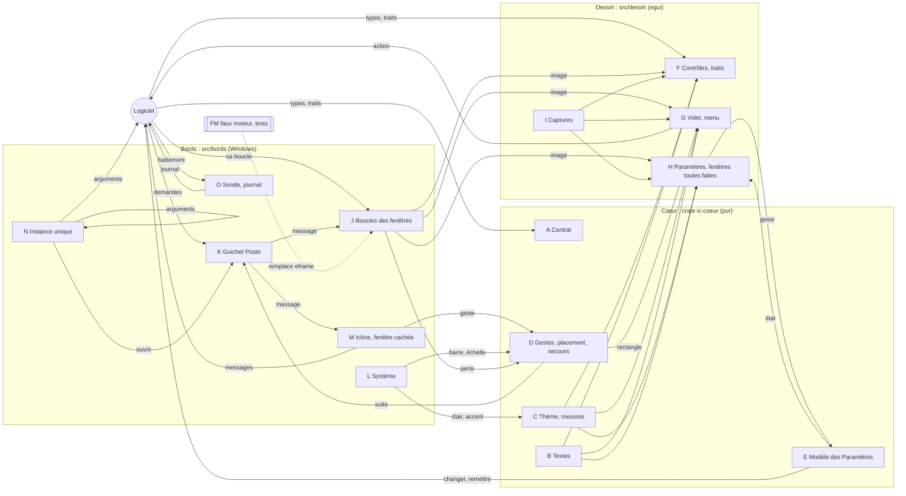

# Interface commune — l'organigramme de la refonte

| Projet | Date | Version de l'organigramme | Relu par |
|---|---|---|---|
| Interface commune | 2026-11-25 | 2 (l'idéal corrigé après sa relecture, et confronté au code) | version 1 relue par un sous-agent neuf (`RELECTURE-IDEAL.md`) ; version 2 à relire par l'Atelier Master |

**D'où vient ce document.** C'est `IDEAL.md` (version 1, écrite sans lire le code), corrigé
point par point d'après `RELECTURE-IDEAL.md` (3 points bloquants, 12 à améliorer) et confronté au
code de `main` et à `ANALYSE.md`. Le propriétaire a choisi le 24 novembre la **refonte à part
(A)** : on réécrit l'intérieur de la bibliothèque sur la branche `refonte`, d'après ce document,
pendant que l'ancienne reste utilisable. `IDEAL.md` reste tel quel, comme trace.

**Sources** :
- **`docs/COMPORTEMENTS.md`** : les 116 comportements à garder, chacun avec son essai. C'est le
  critère de bascule (méthode, §5, étape 4) : la nouvelle bibliothèque n'en perd aucun ;
- les filets posés sur l'ancienne (branche `claude/filets-interface`) : les **images de
  référence** (`tests/references.rs`, 32 images), les **essais de compatibilité**
  (`tests/compatibilite.rs` : chaque chemin et chaque signature que prennent KVMSoft, PowerPeek
  et Vocalis) et `tests/comportements.rs` ;
- `README.md`, `docs/CARTE.md`, `docs/MIGRATION.md`, `docs/ANALYSE.md` (§6 : ce que chaque
  logiciel importe), la fiche commune « Interface Windows 11 ».

Le plan de travail, les dates et la migration des trois logiciels sont dans
`docs/PLAN-REFONTE.md`.

Mots employés :
- une **crate** est un paquet de code Rust compilé à part ; le compilateur y interdit ce qu'on n'y
  veut pas (par exemple : aucun appel à Windows) ;
- une **API** (interface de programmation) est l'ensemble des fonctions et des types que les
  logiciels appellent ; la changer oblige chaque logiciel à changer son code ;
- le **rendu**, c'est ce qui s'affiche au pixel près ;
- **egui** est la bibliothèque qui dessine les fenêtres ; **eframe** et **winit** l'attachent à
  Windows (une seule boucle de fenêtres par programme, imposée par winit) ;
- un **fil** est une partie du programme qui tourne en parallèle des autres ;
- un **trait** est la liste de ce qu'un type doit savoir répondre.

---

## 1. L'idée en trois phrases

L'Interface commune donne aux logiciels du propriétaire qui vivent près de l'horloge de Windows
(KVMSoft, Vocalis, PowerPeek) **la même allure Windows 11 et le même comportement** :
l'icône, le volet, le petit menu, les Paramètres, les fenêtres et leurs contrôles. Le logiciel ne
décrit que ce qui lui est propre (son nom, ses pages, ses réglages, ses actions), par deux traits
(`Reglages` et `Logiciel`). Tout ce qui se décide (quel geste ouvre quoi, où poser le volet, quelle
page montrer, que remettre à « Annuler », quand un fil est bloqué, quand passer au secours) est
calculé sans fenêtre dans un cœur pur et testé avec des exemples ; le code qui parle à Windows est
mince et ne décide rien.

## 2. Les principes propres à cette bibliothèque

1. **L'API est un contrat, gardé par un essai.** Trois logiciels en dépendent, chacun épinglé sur
   un commit. Ce que l'un d'eux prend (chemin, nom, signature) est écrit dans
   `tests/compatibilite.rs`, qui doit compiler à chaque commit. **La refonte ne change aucun de
   ces chemins ni aucune de ces signatures**, sauf les changements listés et décidés dans
   `PLAN-REFONTE.md` §4 (chacun avec sa migration pour chaque logiciel).
   - Ce qui est public sans servir à aucun des trois logiciels (213 éléments, `ANALYSE.md` §1.2)
     peut devenir interne : aucun logiciel n'a rien à changer, l'essai de compatibilité le prouve.
   - Après la bascule, une fonction publique qui sert ne disparaît pas sans une étape « dépréciée »
     (`#[deprecated]`, encore là, avec la ligne de remplacement dans `MIGRATION.md`) qui dure
     jusqu'à la version suivante (0.2.0, puis 0.3.0…).
   - **Ce qui s'est fait jusqu'ici ne suivait pas cette règle** : `MIGRATION.md` montre des
     retraits sans étape dépréciée (`glyphe`, des constantes de `theme`, des variantes de
     `Brique`, des champs ajoutés sans valeur par défaut, `[Rgb; 6]` devenu `[Rgb; 10]`). C'est
     une règle nouvelle, pas une pratique à garder.
   - Le numéro reste 0.1.0 pendant la refonte : c'est à l'Atelier de choisir celui de la bascule.
2. **Le rendu est un contrat aussi.** Chaque écran commun a une **image de référence** faite sans
   fenêtre (`tests/references.rs`). Un changement de rendu non voulu fait échouer l'essai ; un
   changement voulu demande une **décision écrite** (`PLAN-REFONTE.md` §5), puis les images se
   refont dans le même commit (`REFERENCES=refaire`) et le changement se note dans
   `MIGRATION.md`.
3. **Deux étages imposés par le compilateur, un troisième par un essai** (§10) :
   - le **cœur** (crate `ic-coeur`) : aucune dépendance ni à Windows ni à egui ; il reçoit des
     faits (un clic, une taille d'écran, l'instant) et rend des décisions ;
     `#![forbid(unsafe_code)]` ;
   - le **dessin** (dossier `src/dessin/` de la crate `interface-commune`) : egui seul, jamais
     Windows ; il dessine ce que le cœur a décidé ;
   - les **bords Windows** (dossier `src/bords/`) : le seul endroit qui appelle Windows, le seul
     où `unsafe` est permis ; ils transportent, ils ne choisissent pas.
4. **La bibliothèque n'écrit rien sur le disque d'elle-même.** Le journal, la place retenue des
   Paramètres et les réglages passent par le logiciel. Seule exception, sur demande expresse : les
   captures PNG.
5. **Aucune donnée de l'utilisateur dans le journal** : seulement des noms écrits dans le code
   (la règle de la sonde ; à garder partout).
6. **Une seule copie de chaque mesure, couleur, durée et mot** : `mesures`, `theme`, `textes`.
   Aucun nombre magique ailleurs. Les durées de la sonde aussi (§3, bloc O).

## 3. Les blocs

Quinze blocs. Les cinq premiers sont dans le cœur, les quatre suivants dans le dessin, les six
derniers dans les bords. Chaque bloc nomme les comportements (`C-…`) qu'il porte ; la liste
complète, bloc par bloc, est au §13.

### 3.1 Le cœur (crate `ic-coeur`, pure)

#### A. Le contrat (types partagés)
- **Rôle** : les types que le logiciel fournit ou reçoit et qui ne dessinent pas : `Identite`,
  `Etat`, `GenreEtat`, `EtatMiseAJour`, `Credit`, `Communs`, `FenetrePrincipale`, les clés
  communes (`cles`), `Valeur`, `Page`, `Instantane`, `Reveil` (dont `Reveil::Rien` : la seconde
  copie s'arrête sans rien demander), `Niveau` des notifications, `menu::Action`.
- **Ne fait pas** : les traits `Reglages` et `Logiciel` eux-mêmes. Ils gardent leurs méthodes qui
  dessinent (`dessiner_page`, `dessiner_general`, `dessiner_pied`, `briques_avec_contexte`…) et
  prennent donc egui : **ils restent dans la crate `interface-commune`** (bloc F), à leur chemin
  d'aujourd'hui. Les sortir des traits casserait les trois logiciels sans rien leur donner ;
  Rust interdit en outre d'ajouter des méthodes à un trait d'une autre crate.
- **Entrées / sorties** : rien à l'exécution ; ce sont des types.
- **Touche le système ?** non.
- **Test sans matériel** : un faux logiciel de données inventées (`Fictif`, déjà écrit pour les
  images de référence), réutilisé par tous les autres tests.

#### B. Les textes
- **Rôle** : chaque mot écrit par la bibliothèque, en français et en anglais, dans un seul
  catalogue (`Textes`), changeable en direct ; les raccourcis en toutes lettres
  (`touches::lisible`) ; **l'espace insécable avant chaque unité** (C-98 : « 15 s », « 42 % »).
- **Ne fait pas** : choisir la langue (c'est le logiciel) ; traduire une touche d'egui (dessin).
- **Entrées / sorties** : une langue → un `&Textes` ; une écriture de raccourci → un texte lisible.
- **Touche le système ?** non.
- **Test sans matériel** : les deux catalogues ont les mêmes champs, aucun vide ; `lisible` ne
  change pas deux fois ; aucun « {} » suivi d'une espace simple puis d'une unité (C-98, sans écart
  permis à la bascule) ; chaque caractère existe dans les polices (essai du bloc O, sous Windows).

#### C. Le thème et les mesures (valeurs)
- **Rôle** : la palette Fluent clair et sombre, les couleurs d'état, les 10 couleurs des
  pastilles (ΔE2000 ≥ 12), les glyphes des icônes communes (`icones`), les durées d'animation et
  leur courbe, les mesures du volet, du menu et des Paramètres, l'opacité d'une image
  d'animation ; et **la décision de suivre Windows** : relire le clair ou sombre et l'accent
  **toutes les 2 s** et changer la palette dès qu'ils changent (C-90), sauf thème imposé par le
  logiciel. On garde la relecture toutes les 2 s (c'est ce que fait l'ancienne, essayé) : aucune
  écoute d'un message Windows n'est ajoutée.
- **Ne fait pas** : lire Windows (bloc L), charger les polices (bloc L), convertir une couleur en
  couleur d'egui (bloc F).
- **Entrées / sorties** : clair ou sombre, l'accent, « effets d'animation » oui ou non, l'instant
  → couleurs, tailles, opacité ; l'instant de la dernière lecture → « relire maintenant » ou non.
- **Touche le système ?** non.
- **Test sans matériel** : contrastes (4,5:1, 3:1), écart des pastilles (paires de Sharma),
  courbe d'animation à des instants donnés, animation jouée en entier même après une image
  retardée, relecture à 2 s avec une fausse horloge.

#### D. Les gestes, le placement et les secours
- **Rôle** :
  - traduire ce que fait l'utilisateur sur l'icône (appui, relâche, double-clic, clavier) en une
    suite (volet, petit menu, fenêtre principale, Paramètres, rien), avec l'anti-rebond (400 ms)
    et le second clic qui referme ; **un seul aiguilleur** (aujourd'hui écrit deux fois, dans
    `horloge` et dans `zone`) ;
  - l'ordre du petit menu ; le clic dedans ou dehors du volet (C-28) ;
  - la place du volet, du petit menu et des Paramètres près de l'icône et de la barre des
    tâches, la hauteur bornée, la place retenue ramenée sur un écran et jamais celle d'une fenêtre
    réduite (C-79), le plan des écrans d'un choix illustré (`plan_des_cases`), la place d'un menu
    de choix (`menu_choix::placer`), la place au changement d'échelle ;
  - **les décisions de secours** : « 3 pertes de la fenêtre en 60 s → menu de secours » (C-51),
    « une fenêtre ne répond plus → la fermeture n'attend pas plus de 5 s » (C-12) ;
  - le découpage d'une info-bulle trop longue sans couper un caractère (C-07), « même image →
    rien à renvoyer à Windows » (C-05).
- **Ne fait pas** : demander à Windows où est la barre ni l'heure (elles arrivent en paramètre).
- **Entrées / sorties** : un geste, l'instant, le réglage « fenêtre principale » → une suite ; la
  place de l'icône, de la barre et de la zone de travail, la taille voulue → un rectangle ; une
  suite de pertes datées → « recréer » ou « passer au secours ».
- **Touche le système ?** non.
- **Test sans matériel** : tables d'exemples (barre en bas, en haut, à gauche, écrans à 100 % et
  150 %, écrans aux coordonnées négatives, fenêtre réduite à -32 000) ; rafales de clics et de
  pertes avec une fausse horloge.
- **Types** : le cœur a ses propres rectangles (`place::Rect`, des entiers, comme aujourd'hui).
  `plan_des_cases` et `menu_choix::placer` gardent leur signature d'aujourd'hui (rectangles
  d'egui) dans la crate `interface-commune` : ce sont de minces enveloppes qui convertissent et
  appellent le cœur.

#### E. Le modèle des Paramètres
- **Rôle** : tout ce qui se décide dans les Paramètres sans les dessiner :
  - la liste des pages (Accueil facultatif, pages du logiciel, puis Général, Mise à jour,
    À propos), la navigation, la recherche (dès 7 pages, accents et majuscules sans importance,
    sections trouvées), le point d'alerte, la page demandée (`--parametres <page>`,
    notification), le suivi des pages arrivées après l'ouverture ;
  - **« Annuler », règle C-70 telle quelle** : un réglage change tout de suite ; la bulle
    « Annuler » reste 6 s, puis le changement est gardé ; deux changements de suite gardent
    l'« avant » du premier ; avec un brouillon (`instantane`, `remettre`), « Annuler » remet le
    brouillon entier ;
  - « Conserver ces modifications ? » (15 s, une à la fois), « Redémarrer maintenant » (C-78) ;
  - la présentation de la page Mise à jour (état → icône, titre, ligne grise, bouton :
    aujourd'hui dans `parametres/mod.rs`, à ranger ici) ;
  - la largeur de la navigation selon les noms des pages (C-80).
- **Ne fait pas** : dessiner, lire l'heure (elle arrive en paramètre), enregistrer.
- **Entrées / sorties** : les pages et les `Communs` du logiciel, les gestes de l'utilisateur,
  l'instant → l'état des Paramètres (page montrée, bulle, compte à rebours) et les changements à
  envoyer au logiciel (`changer`, `remettre`, `peut_fermer`, `retenir_place`).
- **Touche le système ?** non.
- **Test sans matériel** : suites de gestes avec une fausse horloge (bulle qui expire, retour
  après 15 s, nouveau changement pendant un compte à rebours, page disparue).

### 3.2 Le dessin (crate `interface-commune`, dossier `src/dessin/`, egui seul)

#### F. Les contrôles communs, et les traits
- **Rôle** : les traits **`Reglages` et `Logiciel`** (inchangés, `Send + Sync + 'static` : ils
  sont appelés depuis le fil des fenêtres, le fil de l'icône et le chien de garde) ; cartes,
  interrupteur (écrit ou non), bandeau, boutons, focus visible (C-104), champ de raccourci, roue
  dentée, nuancier, choix de couleur, barre à seuils, menu flottant de choix, section repliable,
  pastilles, briques du volet (`Brique`, qui porte une texture d'egui et reste donc ici) ; la
  conversion des couleurs du cœur en couleurs d'egui ; la traduction d'une touche d'egui pour
  `touches`.
- **Ne fait pas** : décider (les touches du menu de choix, le placement, la recherche viennent du
  cœur).
- **Entrées / sorties** : une palette, des textes, la valeur courante → ce que l'utilisateur a
  fait (valeur changée, choix).
- **Touche le système ?** non.
- **Test sans matériel** : mise en page egui sans fenêtre ; images de référence ; navigation au
  clavier simulée (Tab, flèches, Entrée, Échap) ; noms pour le lecteur d'écran.

#### G. Le volet et le petit menu (dessin)
- **Rôle** : dessiner le volet (titre = nom du logiciel, version à sa droite, roue en haut à
  droite, ligne d'état, détail qui passe à la ligne (C-25), briques, pied fixe, défilement au-delà
  de la hauteur maximale, flèches du clavier comme Tab (C-33)) et le petit menu (lignes de 32 + 2,
  icône, gras pour « Ouvrir <logiciel> ») ; la surface commune (`surface::dessiner_borne`).
- **Ne fait pas** : décider de la place ni de l'ordre du menu (bloc D), gérer la fenêtre (bloc J).
- **Entrées / sorties** : `Etat`, briques, lignes du menu → le choix fait (clé, réglage changé,
  Paramètres, fermer).
- **Touche le système ?** non.
- **Test sans matériel** : deux images de suite ne reconstruisent rien ; images de référence ;
  titre coupé par « … » sans passer sous la roue.

#### H. Les Paramètres (dessin) et les fenêtres toutes faites
- **Rôle** : dessiner le squelette des Paramètres (en-tête avec logo, navigation, recherche,
  pages communes, bulle « Annuler », carte « Conserver ? », bandeau « Redémarrer », pied) d'après
  l'état du bloc E, et appeler les pages du logiciel ; `Parametres::dessiner`, qu'un logiciel peut
  appeler **dans sa propre boucle** (§6) ; la fenêtre simple, la fenêtre « est prête » et la
  fenêtre de lecture.
- **Ne fait pas** : décider de la page, de la bulle ni du compte à rebours (bloc E) ; ouvrir la
  fenêtre (bloc J).
- **Entrées / sorties** : l'état du bloc E, le logiciel → les gestes, rendus au bloc E.
- **Touche le système ?** non.
- **Test sans matériel** : images de référence de chaque page commune et de chaque état de la
  page Mise à jour ; recherche qui ouvre une section.

#### I. Les captures
- **Rôle** : faire des PNG du volet, du petit menu, des Paramètres, des fenêtres toutes faites et
  de tout dessin, sans fenêtre (rendu logiciel), pour la documentation et les images de
  référence.
- **Ne fait pas** : ouvrir une fenêtre, lire l'écran.
- **Entrées / sorties** : un logiciel (souvent inventé), une échelle, clair ou sombre → des PNG.
- **Touche le système ?** disque, seulement pour écrire les PNG demandés ; il lit les polices de
  Windows (bloc L) comme tout dessin.
- **Test sans matériel** : c'est lui qui rend possibles les tests de rendu. La fenêtre simple et
  la fenêtre « est prête » ont déjà leurs images ; la fenêtre de lecture est à ajouter.

### 3.3 Les bords Windows (crate `interface-commune`, dossier `src/bords/`, seul `unsafe`)

#### J. Les boucles des fenêtres
- **Rôle** : faire tourner les fenêtres, de **deux façons**, toutes deux gardées :
  1. **la boucle de la bibliothèque** (`Horloge::lancer`, `lancer_le_fil_des_fenetres`) : sa
     fenêtre principale est celle du volet et du petit menu, préparée au repos, voilée jusqu'à son
     ouverture, jamais refaite ; elle dessine aussi les autres fenêtres (Paramètres, fenêtres du
     logiciel, `autres_fenetres::Ouverture`) ;
  2. **la boucle du logiciel** : un logiciel qui garde sa propre boucle eframe (PowerPeek) y fait
     dessiner les fenêtres communes : `autres_fenetres::AutresFenetres` (`lier`, `montrer`),
     `parametres::fenetre::ouvrir_dans_boucle`, `Parametres::dessiner`,
     `echelle::suivre_windows`, et la supervision `fenetres::superviser_les_fenetres` (avec
     `envoyer_le_clic`, `Demande`).
- **Les paniques** : une panique dans le contenu d'**une** fenêtre est attrapée autour de cette
  fenêtre seule, notée avec son lieu, et les autres continuent (C-62) ; une création ratée
  n'arrête rien et un nouvel essai suit (C-60) ; une panique d'eframe dans la boucle elle-même
  est attrapée autour du tour de boucle, puis la fenêtre est recréée et le clic en cours refait,
  **selon la décision du bloc D** (3 pertes en 60 s → secours).
- **Ne fait pas** : décider quoi montrer ni quand passer au secours (cœur), dessiner le contenu
  (dessin).
- **Entrées / sorties** : les demandes du guichet (bloc K) → des fenêtres à l'écran, les gestes
  rendus au logiciel.
- **Touche le système ?** oui (fenêtres, OpenGL).
- **Test sans matériel** : un **faux moteur de fenêtres** (§5, case `FM`) : le trait que la
  boucle appelle pour créer, montrer et perdre une fenêtre (`Supervise` aujourd'hui), avec une
  version de test qui perd une fenêtre ou panique sur commande ; il essaie la recréation, la
  supervision et les paniques sans eframe. Les essais en vraies fenêtres tournent seulement en
  vérification GitHub (§11).

#### K. Le guichet (`Poste`)
- **Rôle** : la porte entre les fils du logiciel et **la boucle de la bibliothèque** : notifier,
  redessiner, ouvrir les Paramètres ou une fenêtre, fermer, quitter, faire du code sur le fil de
  l'icône. Chaque demande est un **message** ; le guichet réveille le fil qui doit le traiter.
- **Ne fait pas** : traiter la demande lui-même. Il n'est pas la seule porte : un logiciel qui a
  sa propre boucle (bloc J, façon 2) parle à ses fenêtres communes directement, sur son fil ; et
  la sonde (bloc O) s'appelle de tout fil.
- **Entrées / sorties** : une demande, depuis n'importe quel fil → un message dans la boîte du
  bon fil.
- **Touche le système ?** oui, pour réveiller une fenêtre (un message Windows).
- **Test sans matériel** : rafales de demandes depuis plusieurs fils, avec un faux réveil.

#### L. Le système Windows
- **Rôle** : lire le mode sombre, l'accent, « Effets d'animation », la barre des tâches, la zone
  de travail, l'écran autour d'un point, la place de la souris, le temps du double-clic (C-112) ;
  poser le réglage d'échelle du processus au démarrage (C-113) et suivre l'échelle
  (`WM_DPICHANGED`) ; charger Segoe UI Variable et Segoe Fluent Icons, avec le repli de Windows 10
  (Segoe UI, Segoe UI Semibold, Segoe MDL2 Assets, C-92) ; DWM (coins, ombre, voile) ; fenêtres
  sans focus, sans cadre, sans fantôme ; sélecteur de dossier ; disque local seulement ; **une
  seule fabrique de fenêtre cachée** (aujourd'hui écrite trois fois).
- **Ne fait pas** : décider (les rectangles reçus vont au cœur).
- **Entrées / sorties** : des questions précises → des faits bruts.
- **Touche le système ?** oui, c'est son seul rôle.
- **Test sans matériel** : impossible en entier ; chaque fonction a un équivalent pur testé dans
  le cœur ; les lectures sans fenêtre (C-112, C-113, C-92) s'essaient sur le PC ; le reste tourne
  en vérification GitHub.

#### M. L'icône et la fenêtre cachée (`Horloge`, `Zone`)
- **Rôle** : poser, changer et retirer une ou plusieurs icônes près de l'horloge (GUID stable
  tiré d'une graine donnée par le logiciel, `guid_stable` ; l'icône seule garde son identifiant
  d'aujourd'hui) ; l'image depuis des pixels RVBA (C-10) ; l'ajout refusé repris en modification
  (C-09) ; la fenêtre cachée et sa boucle de messages ; les notifications à trois niveaux et le
  clic sur une notification ; la remise des icônes quand l'Explorateur redémarre ; le menu gris de
  secours (mêmes lignes, même ordre, C-45) ; la fin de session (`FinDeSession`, C-11) et le
  changement d'affichage (C-13) rendus au logiciel ; les messages Windows rendus au logiciel
  (`recevoir_messages`). **`Horloge` devient une façade sur une `Zone` à une seule icône** : un
  seul système, une seule fenêtre cachée, un seul menu de secours ; `FenetresCommunes` reste pour
  le logiciel qui garde sa boucle.
- **Ne fait pas** : choisir la suite d'un geste (bloc D).
- **Entrées / sorties** : messages Windows → gestes pour le bloc D ; demandes → appels au shell.
- **Touche le système ?** oui.
- **Test sans matériel** : le décodage des messages (pur) ; la remise après l'Explorateur avec un
  faux shell.

#### N. L'instance unique
- **Rôle** : une seule copie du logiciel, par un verrou nommé dans l'espace de la session
  (`Local\`, C-18) ; la seconde transmet ses arguments à la première (bornés : 16, 4 Ko, marqués,
  vérifiés) ou lui demande de s'ouvrir (`Reveil::Parametres`) ou rien (`Reveil::Rien`), puis
  s'arrête ; le canal qui ouvre une page demandée (C-17).
- **Ne fait pas** : interpréter les arguments (le logiciel).
- **Entrées / sorties** : le nom du logiciel, le `Reveil` → « je suis seul » ou « transmis ».
- **Touche le système ?** oui (verrou nommé, message entre programmes).
- **Test sans matériel** : codage et lecture des arguments (pur) ; le verrou dans `Local\` (essai
  sans fenêtre) ; un essai entre deux vrais programmes en vérification GitHub.

#### O. La sonde, le journal et la vérification
- **Rôle** :
  - la sonde des fils : `sonde::inscrire`, `battement`, `etape`, `imbriquee`, **appelables de
    tout fil, ceux du logiciel compris** ; le chien de garde (un fil) ; le lieu d'une panique ;
  - **les délais** (battement attendu, « bloqué depuis… ») : une seule copie, dans `Delais`, que
    le logiciel peut changer par `sonde::regler` ; 15 s n'est que la valeur par défaut ;
  - **le journal** : `sonde::brancher_le_journal` reçoit la fonction d'écriture du logiciel
    (C-110). C'est le chemin pour un logiciel qui n'a pas de `Logiciel` (qui ne prend que les
    Paramètres) ; un logiciel qui a un `Logiciel` reçoit aussi les lignes par
    `Logiciel::noter`. Sans l'un ni l'autre, les lignes sont perdues (rien n'est écrit sur le
    disque, principe 4) ;
  - les contrôles pour les tests des logiciels (`verification` : chaque caractère et chaque icône
    existe dans les polices de Windows, `logos_absents`).
- **Ne fait pas** : réparer un fil bloqué ; décider qu'un fil est bloqué (bloc D : décision pure
  d'après les battements datés et les délais).
- **Entrées / sorties** : battements et étapes → lignes de journal.
- **Touche le système ?** la sonde lance un fil ; la vérification lit les polices.
- **Test sans matériel** : la décision « bloqué » est essayée avec une fausse horloge et des fils
  simulés ; le branchement du journal par un clic de sonde (C-110).

## 4. Le tableau des flux (il fait foi)

| De | Vers | Ce qui circule | Sens / déclencheur |
|---|---|---|---|
| Logiciel | A, F (contrat, traits) | identité, état, briques, pages, `Communs` | lu à chaque image, sans disque |
| M (icône) | D (gestes) | geste décodé, place de l'icône, instant | message Windows sur l'icône |
| D (gestes) | K (guichet) | la suite : volet, menu, principale, Paramètres, secours | après chaque geste |
| D (placement) | G (volet, menu) | le rectangle où dessiner | à l'ouverture |
| L (système) | D (placement) | barre, zone de travail, échelle, souris | à l'ouverture du volet ou du menu |
| L (système) | C (thème) | clair ou sombre, accent, effets d'animation | relu toutes les 2 s (C-90) |
| K (guichet) | J (boucle de la bibliothèque) | demande d'ouverture, de redessin, de fermeture | message + réveil de la fenêtre |
| K (guichet) | M (icône) | notifier, changer l'icône, code sur le fil de l'icône | message Windows à la fenêtre cachée |
| Logiciel (tout fil) | K (guichet) | notifier, redessiner, ouvrir, quitter | appel de `Poste` |
| Logiciel (sa boucle) | J (façon 2) | le contexte egui de sa boucle, les fenêtres à montrer | `lier`, `montrer`, `ouvrir_dans_boucle`, `superviser_les_fenetres` |
| J (boucles) | F, G, H (dessin) | le contexte egui, l'image à faire | à chaque image |
| J (boucles) | D (secours) | une perte ou une panique datée | à chaque perte |
| C (thème) | F, G, H (dessin) | palette, mesures, opacité de l'image | à chaque image |
| B (textes) | F, G, H (dessin) | les mots dans la langue du logiciel | à chaque image |
| E (modèle) | H (Paramètres, dessin) | page montrée, bulle, compte à rebours | à chaque image |
| H (Paramètres, dessin) | E (modèle) | geste dans une page (changer, annuler, conserver) | clic ou touche |
| E (modèle) | Logiciel | `changer`, `remettre`, `peut_fermer`, `retenir_place` | après décision |
| G (volet, dessin) | Logiciel | action choisie, réglage changé | clic dans le volet ou le menu |
| N (instance, seconde copie) | N (première copie) | arguments ou demande d'ouverture | message entre programmes |
| N (première copie) | Logiciel, K | arguments (`recevoir_arguments`), ouverture des Paramètres | à l'arrivée du message |
| M (icône) | Logiciel | messages Windows qui ne sont pas à la bibliothèque, fin de session, changement d'affichage | `recevoir_messages`, `FinDeSession` |
| tous les fils, ceux du logiciel compris | O (sonde) | battement, étape | à chaque tour de boucle, avant un appel à risque |
| O (sonde) | Logiciel | ligne de journal (jamais de donnée de l'utilisateur) | `brancher_le_journal`, `Logiciel::noter` |
| I (captures) | F, G, H | demande de dessin sans fenêtre | tests, documentation |

## 5. Le schéma

Le même que le tableau, flèche pour flèche. `FM` est le faux moteur de fenêtres des tests : il
prend la place d'eframe sous J.

La flèche « tous les fils → O » est dessinée depuis le logiciel seulement, pour ne pas croiser
tout le schéma ; le tableau fait foi.

## 6. Les fils

| Fil | Ce qu'il fait | Comment il parle aux autres |
|---|---|---|
| **Icône** (fenêtre cachée) | boucle de messages Windows : icônes, notifications, menu de secours, messages du logiciel | reçoit les demandes par messages Windows ; envoie les gestes au fil des fenêtres par une boîte à messages (canal) |
| **Fenêtres de la bibliothèque** | la boucle eframe de la bibliothèque : volet, petit menu, Paramètres, autres fenêtres | lit sa boîte à messages à chaque image ; réveillé par le guichet quand il dort (volet caché) |
| **Boucle du logiciel** (façon 2 du bloc J, PowerPeek) | la boucle eframe du logiciel, qui dessine aussi les fenêtres communes | appelle directement `AutresFenetres`, `ouvrir_dans_boucle`, `Parametres::dessiner`, `superviser_les_fenetres` ; parle au fil de l'icône par `FenetresCommunes` |
| **Chien de garde** | lit les compteurs de battements à l'intervalle de `Delais` (5 s par défaut) | ne fait qu'écrire au journal |
| **Fils du logiciel** | ce qu'il veut | par le guichet (`Poste`) pour la boucle de la bibliothèque ; la sonde (`inscrire`, `battement`, `etape`) de tout fil |

Un programme a **une seule** boucle eframe (winit) : celle de la bibliothèque **ou** celle du
logiciel, jamais les deux. Les Paramètres seuls (trait `Reglages`, sans icône ni volet, C-82)
s'ouvrent dans l'une ou l'autre.

Par défaut, des messages, pas des verrous. Verrous permis et listés :
- la **copie lue du logiciel** : les traits sont appelés depuis plusieurs fils (d'où
  `Send + Sync`) ; le logiciel protège lui-même ses données (c'est son état) ;
- la **sonde** : un compteur atomique et un petit verrou sans attente par fil ;
- les **fenêtres à soi** de la façon 2 (`AutresFenetres`) : un verrou par liste de fenêtres,
  partagé entre le fil du logiciel qui demande et la boucle qui dessine.

Un verrou empoisonné (un fil a paniqué en le tenant) est repris par **un seul mécanisme** commun,
`src/bords/verrou.rs` (`verrou`, et `lecture`, `ecriture` pour un verrou de lecture), jamais par
un `unwrap` : la sonde, le guichet, les polices, la reprise et les boucles des fenêtres passent
tous par lui.

## 7. Où vit l'état

- **L'état du logiciel** (réglages, appareils, écoute…) vit chez le logiciel. La bibliothèque n'en
  garde aucune copie durable : elle le lit par les traits à chaque image.
- **L'état de l'interface décidé par la bibliothèque** (volet ouvert ou non, page montrée, bulle
  « Annuler », compte à rebours, place des fenêtres) vit **dans le fil qui dessine** (celui de la
  bibliothèque ou celui du logiciel), dans une seule structure par fenêtre, changée seulement par
  le cœur (blocs D et E) d'après les gestes.
- **L'état laissé à egui**, qu'on ne recopie pas : le focus du clavier, la position du
  défilement, la section repliable ouverte ou fermée, le survol. egui le garde d'une image à
  l'autre ; il est perdu si la fenêtre est recréée, et c'est accepté.
- **L'état gardé par le logiciel** : un menu de choix (`menu_choix::MenuChoix`) vit dans la
  structure du logiciel qui l'a créé, comme une variable de sa page.
- **L'état global modifiable**, permis seulement dans les bords et commenté
  `// ÉTAT GLOBAL : <pourquoi>` :
  - les polices chargées une fois (lecture de Windows coûteuse, partagée par toutes les
    fenêtres) ;
  - les compteurs, les délais et la fonction de journal de la sonde (un par fil, lus par le chien
    de garde, posés par `regler` et `brancher_le_journal`) ;
  - le lieu de la dernière panique (posé par le crochet de panique, qui ne reçoit aucun
    paramètre) ;
  - le verrou d'instance unique (il doit vivre aussi longtemps que le programme) ;
  - l'état de réveil de Windows (`bords/reprise.rs` : veille, écran éteint), signalé par le fil
    de l'icône et la sonde, lu par toutes les boucles de fenêtres ;
  - ce que Windows ne passe que par une procédure sans paramètre ou à tout le processus : le
    jeton des messages internes de l'icône (`icone/decodage.rs`), le rectangle suggéré d'un
    changement d'échelle (`systeme/echelle.rs`), les fenêtres déjà prises par une boucle
    (`fenetres/autres.rs`) ;
  - ce qui doit survivre à la recréation de la boucle des fenêtres après une panique, ou être
    posé par une fonction publique sans poignée : `fenetres/volet.rs` (`OBSERVATEUR`, `DISCRET`,
    `DEJA_OUVERTE`, `DEJA_PREPAREE`), `fenetres/autres.rs` (`GARDER_CACHEES`),
    `fenetres/autres/delais.rs` (`AFFICHAGE_CHANGE`).

  Chacun dit pourquoi au-dessus de sa déclaration. Rien d'autre : en particulier aucun état global
  dans le cœur ni dans le dessin (le compteur des ouvertures des Paramètres, `OUVERTURES`, a
  disparu au bloc Transversal : chaque ouverture tire un numéro au hasard). Les essais gardent
  quelques états globaux à eux, commentés de même.

## 8. Les fichiers écrits

| Fichier | Rôle | Version du format | Écrit par | Si plus récent ou abîmé |
|---|---|---|---|---|
| aucun | la bibliothèque n'écrit rien d'elle-même (principe 4) | — | — | — |
| PNG des captures | documentation | sans objet (image) | I, sur demande | écrasé : c'est une sortie |
| images de référence (`tests/references/images/`) | contrat du rendu | **pas de version dans le nom** : Git garde l'histoire ; une image ne change que si le rendu change. L'empreinte des polices qui les ont faites est dans `tests/references/polices.txt` | `tests/references.rs`, en mode « refaire » seulement | mode « comparer » (par défaut) : un écart fait échouer l'essai et écrit l'image rendue et une image des écarts dans `captures/` ; polices différentes : comparaison sautée, avec un message |

La place retenue des Paramètres, le journal et les réglages sont des fichiers **du logiciel** :
la bibliothèque lui donne les valeurs, il les écrit avec ses propres numéros de version. La
refonte ne change pas ce qu'elle lui donne (`Place` garde ses champs) : les fichiers des
logiciels n'ont rien à migrer.

## 9. Les erreurs

- **À l'intérieur**, des erreurs nommées par bloc (icône refusée par le shell, police absente,
  fenêtre perdue, instance déjà là, argument refusé…), jamais de `panic`.
- **À l'API, les types d'aujourd'hui restent** : `lancer` rend `Result<(), String>`,
  `instance_unique` et `instance_unique_avec` rendent `Result<Unique, bool>`. Les erreurs nommées
  sont traduites en ces types à la frontière. Un type d'erreur commun (`ErreurInterface`) à l'API
  changerait les trois logiciels sans leur donner de geste nouveau : il n'est pas fait.
- Les bords écrivent l'erreur au journal (bloc O), passent au secours (menu gris de Windows,
  police de repli, menu de secours sans OpenGL) et continuent.
- **Les paniques** (bibliothèques d'autrui qui gardent des `unwrap`, contenu d'une fenêtre écrit
  par le logiciel) sont attrapées à **deux sortes** d'endroits, et seulement là :
  - autour du contenu de **chaque** fenêtre et de chaque création de fenêtre (C-62, C-60) : la
    fenêtre fautive est fermée ou recréée, les autres continuent ;
  - autour d'un tour de la boucle eframe : la fenêtre est recréée, selon la décision du bloc D.

  Chaque panique attrapée est notée avec son lieu (bloc O).
- Fatal, au démarrage seulement : aucune boucle de fenêtres possible et aucun secours. Le logiciel
  reçoit une erreur, la bibliothèque ne quitte jamais le programme elle-même.
- Pas d'`unwrap`, d'`expect` ni de `panic` hors des tests (clippy en `deny`, comme aujourd'hui).

## 10. Bloc → dossier ou crate : deux crates, pas quatre

**Décision : deux crates dans un espace de travail Cargo** (plusieurs crates dans le même dépôt).

| Bloc | Crate et dossier | Pur (sans système) ? | Dépendances autorisées |
|---|---|---|---|
| A, B, C, D, E | `crates/ic-coeur` | oui, `#![forbid(unsafe_code)]`, sans egui ni Windows | aucune |
| F, G, H, I | `interface-commune` (racine du dépôt), `src/dessin/` | egui seul, pas Windows : vérifié par un essai (ci-dessous) | `ic-coeur`, `egui`, le rendu logiciel des captures |
| J, K, L, M, N, O | `interface-commune`, `src/bords/` | non (seul `unsafe`, chacun commenté) | `ic-coeur`, `eframe`, `winit`, `windows`, `raw-window-handle`, `skrifa` |
| exemples | `examples/` | — | `interface-commune` |

**Pourquoi deux, et pas une ni quatre** (le doute de la version 1) :
- **Le cœur à part sert** : c'est là que vivent les décisions (gestes, placement, secours,
  Paramètres, sonde). Le compilateur y interdit egui, Windows et `unsafe`, et ses tests tournent
  vite, sans polices ni fenêtre, sur tout système. C'est la promesse « tout ce qui se décide est
  testé sans fenêtre », tenue par le compilateur et non par la relecture.
- **Séparer le dessin des bords en deux crates ne sert pas** :
  - les tests du dessin ont de toute façon besoin des polices de Windows (captures, images de
    référence) : ils ne tournent que sous Windows, comme les bords ;
  - les traits `Reglages` et `Logiciel` portent des méthodes qui dessinent et sont appelés par les
    bords : ils devraient vivre dans la crate du dessin, et les bords dépendre d'elle ;
  - Rust interdit d'écrire, dans une crate, une méthode ou une conversion entre deux types qui
    viennent d'autres crates. Chaque frontière de crate de plus ajoute des enveloppes ;
  - la séparation dessin / bords est tenue autrement : un **essai** (`tests/etages.rs`) lit les
    fichiers de `src/dessin/` et échoue s'il y trouve `windows::`, `unsafe` ou `eframe`.
- **Une façade ne sert plus** : la crate publique garde son nom, `interface-commune`, et c'est la
  vraie crate. Elle reprend le cœur par `pub use` aux chemins d'aujourd'hui
  (`interface_commune::place::Place`, `interface_commune::textes::FRANCAIS`…). Un module en partie
  pur, en partie egui (par exemple `touches`, `apparence`) garde son chemin : sa partie pure vient
  du cœur, sa partie egui est écrite à côté.
- **Ce que voient les logiciels** : la même ligne dans leur `Cargo.toml` (la crate
  `interface-commune` à la racine du dépôt, trouvée par Cargo dans l'espace de travail) ; seul
  `rev` change, plus les changements de `PLAN-REFONTE.md` §4.

### 10.1 Module public d'aujourd'hui → bloc

Chaque module public de `main`, son bloc dans la refonte, et ce qui change pour les logiciels.
« Chemin gardé » : le chemin et les signatures que prend au moins un logiciel restent (essai de
compatibilité) ; l'intérieur est réécrit.

| Module d'aujourd'hui | Lignes | Bloc(s) | Où dans la refonte | Pour les logiciels |
|---|---|---|---|---|
| racine (`lib.rs`) : `Identite`, `Etat`, `GenreEtat`, `EtatMiseAJour`, `Credit`, `Communs`, `FenetrePrincipale`, `FaireLogo` | 446 | A | `ic-coeur`, repris à la racine | chemin gardé |
| racine : traits `Reglages`, `Logiciel` | (dans 446) | F | `src/dessin/traits.rs`, à la racine | chemin et méthodes gardés ; `dessiner_rapides` et `largeur_rapides` retirés (§4 du plan) |
| racine : `Instantane`, `Page`, `Valeur`, `Langue`, `Textes`, `Palette`, `Rgb` | — | A, B, C | `ic-coeur`, repris à la racine | chemin gardé |
| `cles` | (dans 446) | A | `ic-coeur` | chemin gardé |
| `textes` | 422 | B | `ic-coeur` | chemin gardé ; `conserver_retour` et « 24 h » du journal détaillé corrigés (C-98), dans les deux langues (fait au bloc B) |
| `touches` | 301 | B (lisible), F (touches d'egui) | `ic-coeur` + `src/dessin/touches.rs` | chemin gardé |
| `theme` (dont `Surface`, `ChoixWindows`, `ARRONDI_*`, `TAILLE_*`) | 414 | C | `ic-coeur` | chemin gardé ; `ARRONDI_*` (`u8`) et `TAILLE_*` (`f32`) gardés avec leur type et leur valeur (KVMSoft les reprend dans ses dessins) ; `HAUTEUR_LIGNE` retirée (aucun logiciel) |
| `mesures` | 100 | C | `ic-coeur` | chemin gardé |
| `couleurs` | 179 | C (valeurs), F (choix de couleur) | `ic-coeur` + `src/dessin/` | chemin gardé (`palette`) ; **les rangs 0 à 9 sont un format** : KVMSoft envoie à un autre PC le rang de la couleur d'un appareil, donc ni l'ordre ni la valeur des dix couleurs ne changent (essai `les_rangs_des_couleurs_restent`) ; une couleur de plus va derrière |
| `icones` | 91 | C | `ic-coeur` | chemin gardé (`INSTALLER`…) |
| `apparence` (`Apparence`, `couleur`, `choix_windows`) | 156 | C (relire à 2 s), F (`couleur`), L (lecture) | `ic-coeur` + `src/dessin/` + `src/bords/` | chemin gardé |
| `clics` | 201 | D | `ic-coeur` | chemin gardé |
| `menu` (`Action`, `lignes`) | 201 | A (`Action`), D (ordre) | `ic-coeur` | chemin gardé |
| `place` (`Place`, `PlacementVolet`) | 789 | D | `ic-coeur` | chemin gardé |
| `parametres::modele` | 879 | E | `ic-coeur` | chemin gardé |
| `parametres` (`Parametres`, `Parametres::dessiner`, `Parametres::titre_fenetre`, `Contexte`, `TAILLE`) | 1 390 | H (+ E : présentation de la mise à jour) | `src/dessin/parametres/`, un fichier par page | chemin gardé |
| `parametres::fenetre` (`ouvrir_dans_boucle`, `PageVoulue`, `ouverture`, `choisir_dossier`, `icone_fenetre`) | 340 | J | `src/bords/fenetres/parametres.rs`, repris à ce chemin | chemin gardé |
| `dessin` (`focus`, `icone`, `bouton_icone`, `interrupteur_ecrit`, `insecables`, `Genre`…) | 859 | F ; `insecables` : B | `src/dessin/controles/` ; `insecables` (texte pur) dans `ic-coeur` depuis le bloc B | chemin gardé |
| `briques` (`Brique`, `Case`, `Pastille`…) | 780 | F | `src/dessin/briques/` | chemin gardé ; `pourcent` corrigé (C-98) |
| `pastilles` (`marque`, `Marque`, `couleur_lettre`, `plan_des_cases`) | 1 005 | F (dessin), D (plan) | `src/dessin/pastilles/` + `ic-coeur` | chemin et signatures gardés (enveloppe) |
| `menu_choix` (`MenuChoix`, `placer`) | 922 | F (dessin), D (place, touches) | `src/dessin/menu_choix/` + `ic-coeur` | chemin et signatures gardés (enveloppe) |
| `seuils` (`barre_seuils`, `Options`, `ReponseSeuils`, `Zone`) | 526 | F | `src/dessin/seuils.rs` | chemin gardé |
| `nuancier` (`bouton_nuancier`) | 227 | F | `src/dessin/nuancier.rs` | chemin gardé |
| `surface` (`dessiner_borne`) | 417 | G | `src/dessin/surface.rs` | chemin gardé |
| `volet` (dessin, fenêtre, veilleur) | 1 268 | G (dessin), J (fenêtre), D (veille, C-34) | `src/dessin/volet/` + `src/bords/fenetres/volet.rs` | chemin gardé |
| `toutes_faites` (`Simple`, `FenetreSimple`, `ouvrir_simple`, `dessiner_simple`, `Champ`…) | 1 299 | H | `src/dessin/toutes_faites/simple.rs`, `lecture.rs`, `prete.rs` | chemin gardé |
| `capture` (`capture`, `Options`) | 494 | I | `src/dessin/capture.rs` | chemin gardé ; **les images de référence de PowerPeek** (il compare ses pages au pixel avant chaque dépôt) **sont un critère de bascule** (plan §6) |
| `fenetres` (`envoyer_le_clic`, `Demande`, `Ouvert`, `Liens`, `superviser_les_fenetres`) | 1 629 | J (+ D : décision du clic, des pertes) | `src/bords/fenetres/` + `ic-coeur` | chemin gardé |
| `autres_fenetres` (`Ouverture`, `AutresFenetres` avec `lier` et `montrer`, `Contenu`, `Cadre`) | 1 500 | J | `src/bords/fenetres/autres.rs` | chemin gardé ; la boucle du logiciel (`lier`, `montrer`) en fait partie |
| `horloge` (`Horloge`, `Horloge::new`, `Reveil`, `Poste`, `Niveau`, `MessageWindows`, `reglage_dpi`, `instance_unique_avec`) | 1 508 | M, K, N, L, A (`Reveil`, `Niveau`) | `src/bords/icone/`, `poste.rs`, `unique.rs` | chemin gardé (`Horloge` façade sur `Zone`) ; `Horloge::new` reste sans effet sur Windows avant `lancer` : les tests de KVMSoft s'en servent sans jamais attendre |
| `zone` (`Zone`, `FenetresCommunes`, `Aiguilleur`, `guid_stable`, `FinDeSession`, `Image`, `LigneMenu`, `Bouton`, `Evenement`, `Message`, `SuiteDuGeste`) | 1 617 | M (+ D : l'aiguilleur unique) | `src/bords/icone/` + `ic-coeur` | chemin gardé ; GUID de l'icône gardé |
| `systeme` (`ecran_autour`, `position_souris`, `disque_local`, `choix_windows`…) | 802 | L | `src/bords/systeme/` | chemin gardé ; **`disque_local` est une parade de sécurité** (le sélecteur de dossier ne part jamais d'un partage, d'un lecteur réseau ni d'une jonction) : son comportement garde ses essais (C-111) |
| `echelle` (`suivre_windows`) | 90 | L | `src/bords/systeme/echelle.rs` | chemin gardé |
| `polices` (`polices`, `polices_ou_vides`, `semibold`, `icone_disponible`, `dossier`) | 151 | L | `src/bords/systeme/polices.rs` | chemin gardé |
| `sonde` (`inscrire`, `battement`, `etape`, `imbriquee`, `regler`, `Delais`, `brancher_le_journal`, `Inscription`) | 1 027 | O (+ D : décision « bloqué ») | `src/bords/sonde/` + `ic-coeur` | chemin gardé ; `regler` et `Delais` gardés : les tests de KVMSoft règlent la sonde pour ne jamais attendre |
| `verification` (`logos_absents`…) | 164 | O | `src/bords/verification.rs` | chemin gardé |

Trois promesses en plus des chemins (relevées le 25 nov. dans KVMSoft et PowerPeek, rev e077572) :

- **La version d'egui fait partie de l'API.** PowerPeek prend egui en direct (ses pages propres,
  ses dessins) : passer à un autre egui (ou eframe) est un changement d'API, écrit dans
  `MIGRATION.md` avec la migration de chaque logiciel (essai `la_version_d_egui_reste`, 0.37
  aujourd'hui).
- **Le style des fenêtres vient de la seule bibliothèque** (sa boucle et sa `Palette`) : PowerPeek
  ne pose plus de style à lui. Sa fonction `pour_les_fenetres` est à lui (elle ne prend que
  `polices::polices`) ; la bibliothèque n'a rien de ce nom à garder.
- **Les rangs des dix couleurs** (`couleurs::palette`) et **les images de référence de PowerPeek**
  : voir les lignes `couleurs` et `capture` ci-dessus.

Les modules `echelle`, `horloge`, `systeme`, `volet` et `zone` restent réservés à Windows
(`#[cfg(windows)]`), comme aujourd'hui.

Seuils de la méthode : aucun fichier de plus de 800 lignes (600 visés), aucune fonction de plus de
80 lignes ; un module de tests de plus de 200 lignes va dans son propre fichier
(`src/<module>/essais.rs` ou `tests/`).

## 11. Ce que le découpage permet de tester

- **Le cœur** : des tables d'exemples, une fausse horloge, aucun egui, aucune police. Rapide, et
  sur tout système (Linux compris), puisque `ic-coeur` ne dépend de rien.
- **Le dessin** : la mise en page egui sans fenêtre, les images de référence, le clavier. **Sous
  Windows seulement** : il lui faut les polices Segoe de Windows. Les images de référence sont
  faites sur le PC de développement, sans fenêtre (rendu logiciel), avec l'empreinte de ses
  polices ; un poste aux polices différentes (la CI) saute la comparaison et garde ses images à
  part.
- **Les bords** : le faux moteur de fenêtres et un faux shell pour la logique qui reste ; le vrai
  Windows seulement dans les vérifications GitHub (SendInput, deux programmes, Explorateur
  relancé), **jamais en fenêtres sur le PC du propriétaire**.
- **Les comportements** : chaque ligne de `COMPORTEMENTS.md` garde son essai ; un essai qui dit
  « auto » sur l'ancienne le reste sur la nouvelle.
- **La compatibilité** : `tests/compatibilite.rs` reprend les chemins et les signatures que
  prennent KVMSoft, PowerPeek et Vocalis (sans leur code propre) et doit compiler à
  chaque commit de la refonte.
- **Les étages** : `tests/etages.rs` (pas d'appel à Windows dans le dessin).
- **De bout en bout** : l'exemple `demo` lancé sur un bureau Windows caché, piloté par des entrées
  fabriquées (clic, double-clic, clic droit, Entrée, Échap), en vérification GitHub.

## 12. Les doutes

| Doute | Qui tranche |
|---|---|
| Les pages du logiciel sont dessinées par le logiciel (`dessiner_page`). PowerPeek voudrait une description pure des pages. Une seconde façon, facultative, à côté de l'actuelle ? **Hors de cette refonte** (elle ne change pas l'API) : à reprendre après la bascule. | l'Atelier Master, avec l'Atelier de PowerPeek |
| La tolérance des images de référence (aujourd'hui : 6 par canal, 1 pixel sur 5 000) suffira-t-elle quand le dessin sera réécrit (arrondis différents) ? Si non, une décision écrite par image. | l'Atelier Master, au bloc F |
| Une boucle par programme (winit) : aucune autre voie aujourd'hui ; à revoir à winit 0.31. | veille |
| Les essais en vraies fenêtres (SendInput) ne tournent pas tant que la limite de dépense des Actions est atteinte ; quatre comportements ne s'essaient que là, deux qu'à la main. | le propriétaire (forfait GitHub), par l'Atelier Master |
| Le numéro de version de la bascule (0.2.0 ?). | l'Atelier |

## 13. Les comportements, bloc par bloc

Chaque comportement de `COMPORTEMENTS.md` a un bloc qui le porte. Ceux que la relecture avait
trouvés sans bloc sont en gras.

| Bloc | Comportements |
|---|---|
| A Contrat | C-82 (Paramètres seuls, avec F, H) ; **`Reveil::Rien`** (avec N) |
| B Textes | **C-98** ; raccourcis en toutes lettres ; anglais |
| C Thème, mesures | **C-90** ; couleurs des pastilles ; contrastes ; animation |
| D Gestes, placement, secours | C-01 et les gestes ; **C-05** ; **C-07** ; **C-12** ; **C-28** ; **C-51** ; **C-79** ; anti-rebond ; place du volet et du menu |
| E Modèle des Paramètres | C-70 ; « Conserver ? » ; C-78 ; C-80 ; recherche ; page demandée |
| F Contrôles | C-104 (focus visible) ; menu de choix ; seuils ; nuancier |
| G Volet, menu | C-25 ; C-30, C-31 (première image) ; **C-33** ; **C-34** (veilleur, avec J) |
| H Paramètres, fenêtres toutes faites | pages communes, Mise à jour, fenêtre simple, « est prête », lecture |
| I Captures | C-115 (images de référence) |
| J Boucles des fenêtres | **C-32** ; **C-35** ; C-60 ; C-62 ; recréation ; façon 2 (boucle du logiciel) |
| K Guichet | demandes de tout fil |
| L Système | C-92 ; C-112 ; **C-113** ; DPI ; DWM |
| M Icône | **C-09** ; **C-10** ; **C-11** ; **C-13** ; C-06 (Explorateur) ; C-45 (menu de secours) ; notifications |
| N Instance unique | C-17 ; C-18 ; arguments ; **`Reveil::Rien`** |
| O Sonde, journal | **`sonde::regler`** (les délais) ; C-110 ; boucle imbriquée ; lieu de la panique |

Le tableau complet, comportement par comportement, reste `COMPORTEMENTS.md` (sa colonne « essai »
dit quel fichier le vérifie) : à la fin de chaque bloc, sa session vérifie que les comportements
de son bloc passent sur la refonte.

---

## Liste de contrôle (relecteur et Atelier)
- [x] Le cœur est pur : aucun disque, réseau, heure ni système ; l'instant arrive en paramètre.
- [x] Les décisions sont au cœur, y compris les secours (3 pertes en 60 s, fermeture bornée) et
  « bloqué » de la sonde.
- [x] L'état de l'interface vit dans le fil qui dessine ; ce qui reste à egui et au logiciel est
  dit (§7).
- [x] Les trois usages oubliés par la version 1 sont couverts : boucle du logiciel, Paramètres dans
  la boucle du logiciel, sonde de tout fil (§3 J, K, O ; §6).
- [x] Les paniques sont attrapées par fenêtre (C-62, C-60), pas à un seul endroit (§9).
- [x] Chaque module public d'aujourd'hui a un bloc et une place (§10.1) ; les changements d'API
  sont listés, avec leur migration, dans `PLAN-REFONTE.md` §4.
- [x] Le tableau des flux et le schéma disent les mêmes flèches (la flèche « tous les fils → O »
  est simplifiée, dit au §5) ; 15 blocs.
- [x] Chaque bloc a ses cinq lignes, dont un test sans matériel (L : seulement par ses équivalents
  purs et ses lectures sans fenêtre, dit).
- [x] Chaque comportement a un bloc (§13).
- [x] Aucun fichier de plus de 800 lignes ni fonction de plus de 80 lignes n'est prévu.
- [x] La bibliothèque n'écrit aucun fichier versionné ; les fichiers sont ceux du logiciel.
- [x] Pas de doublon : les commandes restent dans `CARTE.md`, les changements pour les projets dans
  `MIGRATION.md`, le plan et les dates dans `PLAN-REFONTE.md`.
- [x] Aucune donnée privée (règle n° 1) : aucun chemin du PC, aucun nom.
